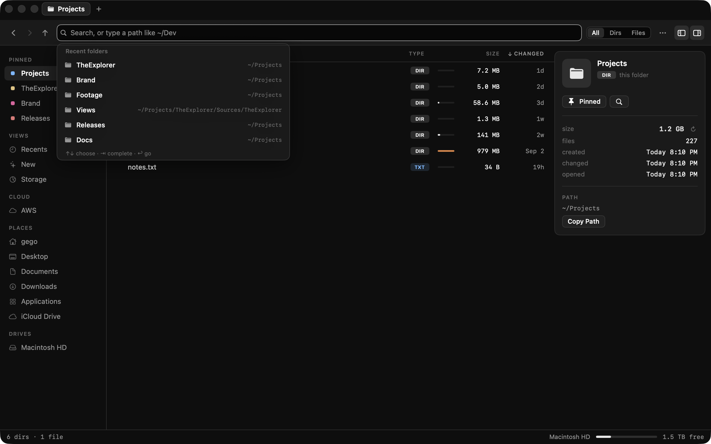
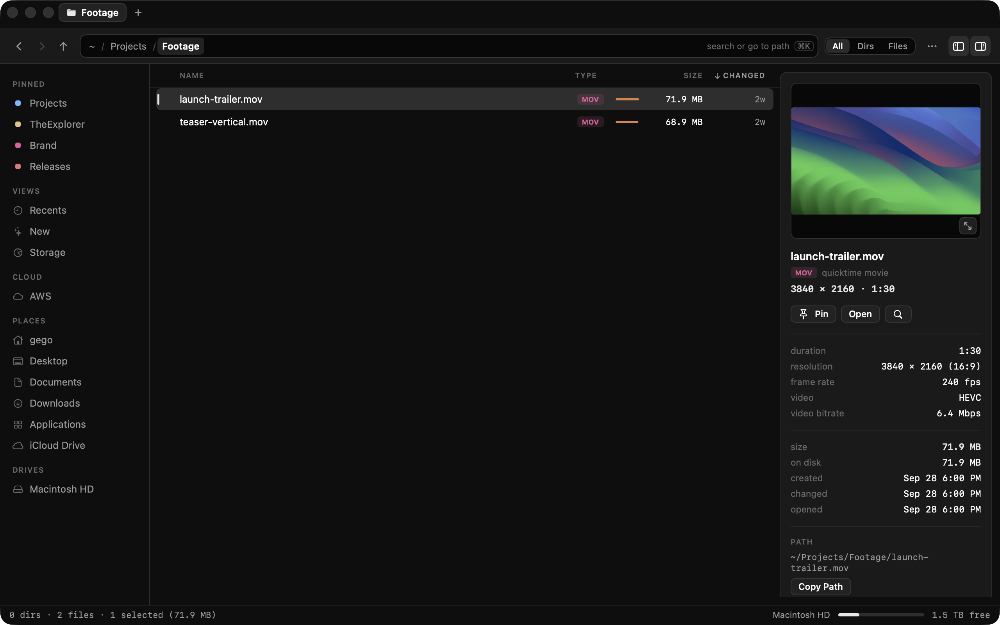
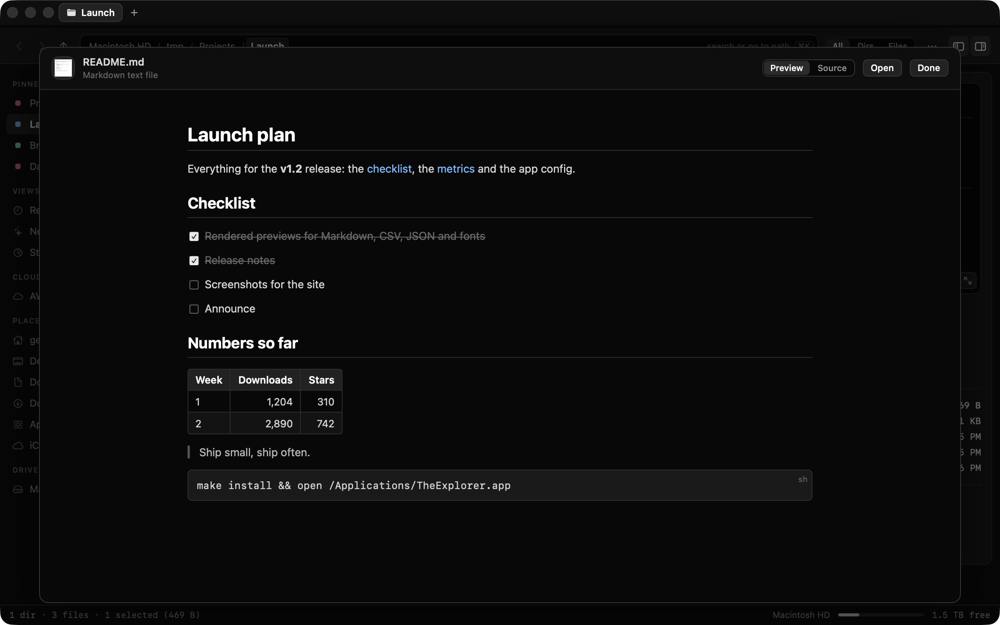
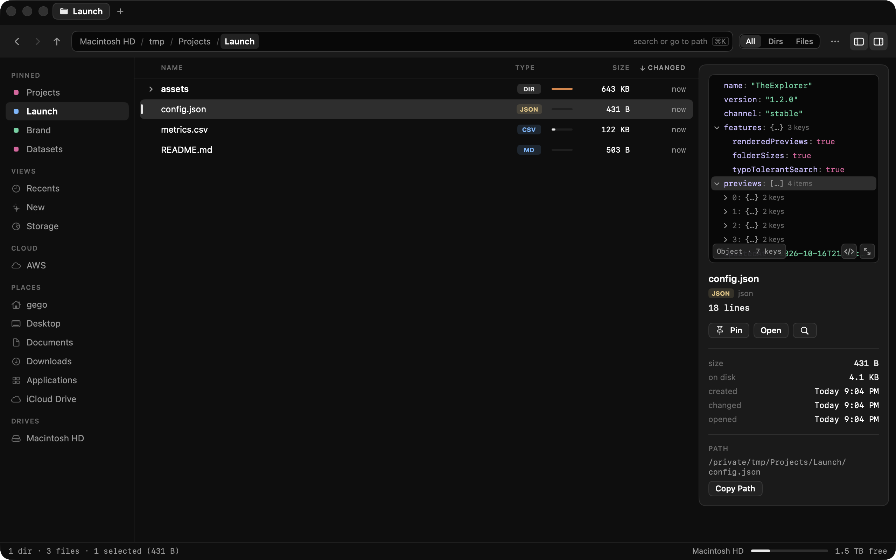
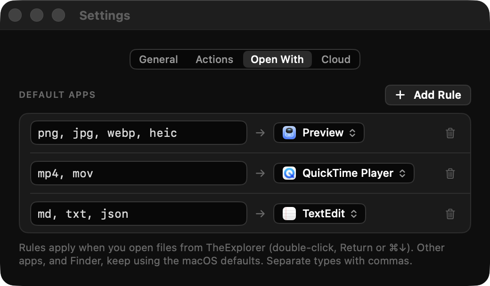

# TheExplorer guide

Everything TheExplorer does and how to use it. For building and working on the code, see [DEVELOPMENT.md](DEVELOPMENT.md).

**Contents:** [Folder sizes](#real-folder-sizes) · [Paths and search](#one-bar-for-paths-and-search) · [Previews](#previews-and-zip-archives) · [Storage](#storage-map) · [S3](#s3-like-a-folder) · [Actions](#actions) · [Recents and New](#recents-and-new) · [Settings](#settings) · [Everything else](#and-the-rest) · [Permissions](#permissions) · [Keyboard shortcuts](#keyboard-shortcuts)

## Real folder sizes

Every folder's total size is calculated in the background and drawn as a bar, so the heavy folders stand out. Type chips (`DIR`, `SWIFT`, `PDF`, `ZIP`…) tell folders from files at a glance, and you can filter to just folders or just files. Click a folder's arrow (or press →) to expand it in place; double-click still opens it.


## One bar for paths and search

The command bar shows where you are as clickable chips. Press ⌘K and type to search, or start with `/` or `~` to jump to a path with folder completion (↑↓ to choose, ⇥ to complete). *Everywhere* searches all your files, and *Here* the current folder and everything below it.

Search works like a launcher's rather than Spotlight's. TheExplorer keeps its own index of file names: your home folder, Applications, iCloud Drive and cloud storage. The index is built once (about a second for a few hundred thousand files) and saved. FSEvents keeps it current from then on, so results update on every keystroke in a few milliseconds. At launch the saved index loads in a few milliseconds. FSEvents then replays whatever changed while the app was closed, and only those folders are re-read.
- **Fuzzy matching.** Matching is case- and accent-insensitive, and the letters you type don't have to be next to each other: `tex` finds *TheExplorer* and `qrp` finds *q3-report.pdf*. Typos are forgiven too: a swapped, missing, extra or wrong letter (two in longer words), so `audit` finds *audting.mp4* and `reciept` finds *receipt.pdf*. Words under four letters, and first letters, have to be right, which keeps short queries clean.
- **Ranking.** Whole names beat prefixes, prefixes beat word starts, and those beat everything else. Recently opened and recently changed files rise to the top.
- **Folder words.** Extra words can match the folders a file is in, so `explorer readme` finds the README inside *TheExplorer*.
- **Recent folders.** TheExplorer learns which folders you work in, the way zoxide does: how often you visit, weighted toward the last hour and day. Passing through a folder doesn't count; staying a moment or opening a file there does. Open ⌘K without typing to see them, or use Go › Recent Folders. They rank higher in search, along with what's in them, so `expl` lands on the project you live in rather than another folder with a similar name, and path completion lists them first.
- **What's left out.** Library, hidden folders, the insides of apps and packages, dependency folders like `node_modules`, Unity's project caches, and any folder a project's `.gitignore` lists (build output, caches) aren't indexed, though the folders themselves are. Generated hash-named files rank last. To search everything in a folder, go there, show hidden files (⇧⌘.) and search *Here*.

<table>
  <tr>
    <td width="50%"></td>
    <td width="50%"></td>
  </tr>
  <tr>
    <td align="center"><sub>Jump anywhere with path completion</sub></td>
    <td align="center"><sub>Search this folder or the whole Mac, typos and all</sub></td>
  </tr>
</table>



## Previews and zip archives

Selecting a document, image, PDF, video, audio or code file shows a live preview in the inspector, along with what's inside it:
- **Images:** dimensions, aspect ratio, color profile, and frame count and length for animations. Camera, lens and exposure appear for photos.
- **SVGs:** size and viewBox.
- **Video:** resolution, length, codec (H.264, HEVC, ProRes, AV1…), frame rate, HDR and bitrates.
- **Audio:** length, codec, sample rate and channels.
- **HLS playlists:** length and segments, or the variants.
- **Everything else:** page count and paper size for PDFs, family and styles for fonts, and line count for text and code.

Markdown, CSV, JSON and fonts are drawn by TheExplorer itself, since Quick Look shows the first three as plain text:
- **Markdown** renders headings, lists and task boxes, tables, quotes, code and images next to the file. Links to other Markdown files open in the preview, with Back to return, and `#section` links jump to that heading. Remote images (like badges) show as labels and aren't downloaded, so previewing a file never reaches out to a server.
- **CSV and TSV** show as a table with a sticky header, row numbers and numbers lined up on the right. The delimiter is detected (commas, semicolons, tabs or pipes), quoted fields work, and the first 1,000 rows are shown while every row is counted.
- **JSON** shows as a tree in the file's own key order. Click a row to open it, ⌥-click to open everything inside, and right-click to copy a value, its path (like `.users[3].name`) or its key. Comments and trailing commas are fine (tsconfig.json, .jsonc), and JSON Lines files list one entry per line.
- **Fonts** show a specimen in the font itself, with every style in the file. Fonts without Latin letters show their own characters.

Click the code button on a preview to see the file's source. Space (or the expand button) opens these files over the window, where fonts also get a size waterfall and a box to type your own text. ↑/↓ step to the next file in the list, and Esc or Space closes it.

For everything else, Space opens Quick Look, and ↑/↓ then step through every file in the list. Selecting a zip lists what's inside as a tree with sizes, without unpacking it: only the archive's table of contents is read, so even huge zips list instantly. Double-click a file inside to preview it, or drag files and folders out to unpack just those.

<table>
  <tr>
    <td width="50%"></td>
    <td width="50%"></td>
  </tr>
  <tr>
    <td align="center"><sub>Dimensions, color and more for images</sub></td>
    <td align="center"><sub>Browse zips without unpacking them</sub></td>
  </tr>
</table>



<table>
  <tr>
    <td width="50%"></td>
    <td width="50%"></td>
  </tr>
  <tr>
    <td align="center"><sub>Markdown, rendered</sub></td>
    <td align="center"><sub>JSON as a tree you can fold</sub></td>
  </tr>
</table>

## Storage map

Scan your home folder, the whole Mac, or any folder. Drill into a treemap and a ranked list with percentages, see the largest files, and compare against total disk usage. Moving something to the Trash updates the totals without a rescan.


## S3, like a folder

Connect S3 in Settings › Cloud and your buckets show up in the sidebar. Browse them like any folder, with the same list, breadcrumbs, back/forward, filtering and inspector.

- **Upload:** drop files or folders onto an S3 folder, a folder row, a breadcrumb or the sidebar connection. Folders upload with everything in them, and big files upload in parallel parts.
- **Download:** drag S3 items onto Finder, the desktop, or any folder, tab, sidebar place or breadcrumb in TheExplorer, or right-click › Download. Folders come down with everything in them, and a name that's taken gets a number instead of being overwritten. Double-click opens a file and Space previews it.
- **Share and manage:** right-click to copy an `s3://` URI or a share link that works for 7 days, create folders, or delete.
- **Progress:** the status bar shows progress with Stop for every transfer.
- **Credentials:** use your AWS CLI profiles as they are. That includes SSO and assumed roles, through `aws configure export-credentials`. Or add access keys, which are kept in your Keychain.
- **Other providers:** S3-compatible services (Cloudflare R2, MinIO, Backblaze B2, Wasabi…) work with a custom endpoint.

The app signs requests itself (AWS Signature Version 4, checked against AWS's published examples) and talks to S3 directly, with no SDK.


## Actions

Turn the shell commands you run on files into one-click actions. Define one in Settings › Actions (a name, the file types it applies to, and the command), then run it from the right-click menu or the Actions menu, where the first nine get ⌃⌥1–9. For example, converting a video to HLS:

```sh
mkdir -p "$NAME-hls"
ffmpeg -nostdin -hide_banner -y -i "$FILE" -codec copy -start_number 0 \
  -hls_time 10 -hls_list_size 0 -f hls "$NAME-hls/$NAME.m3u8"
```

Commands run in zsh with your login profile, so Homebrew tools like `ffmpeg` are found, and they run in the item's folder, so new files appear right next to it. They get `$FILE`, `$FILENAME`, `$NAME`, `$EXT` and `$DIR`, or every selected path as `"$@"` for actions that run once with all items. A status-bar indicator shows progress; click it for each run's output, or to stop one. Stopping ends everything the command started. Templates for HLS, WebP (80% quality, with cwebp), Zip and Copy SHA-256 get you started.

<p align="center"></p>

## Recents and New

- **Recents** works like Finder's: every document you've opened, newest first, grouped into Today, Yesterday, Previous 7 Days, Previous 30 Days and then by month.
- **New** shows the newest files and folders in your home folder by date created, modified or added, from the last 24 hours to 90 days. It updates live, can hide clutter, and keeps loading as you scroll.

## Settings


- **Default file browser.** Send other apps' "Show in Finder" and "Reveal" buttons to TheExplorer. Revealed items open in a tab with the items selected. macOS keeps Finder for folders opened from the Dock, Spotlight or other apps and doesn't let any app take that over, so Settings shows that too, along with the Open With workaround.
- **Terminal.** Choose what "Open in Terminal" (⌃⌘T) uses: Terminal, cmux, Ghostty, iTerm, Warp or any other app. cmux gets a new workspace in the folder.
- **Defaults.** Where new windows start, sort order, folders first, hidden files, and New's time range and clutter filter.

<br clear="right">

## And the rest

- **Tabs.** Browser-style tabs, each with its own folder, history and search. Drop files on a tab to move them there. Tabs come back where you left them after you quit.
- **Split pane.** ⌘/ splits a tab into two folders side by side, each with its own history. Drag the line between them to resize the panes, or double-click it to even them out. The active pane has a bright line along its header, and the command bar, sidebar, inspector and menus all act on it. Click a pane or press Tab to switch. F5 copies the selection to the other pane's folder and F6 moves it there (also in the right-click menu), or drag between them. View › Swap Panes and Show Same Folder in Other Pane are there too. ⌘W closes the active pane, and splits (and where you left the divider) come back after you quit.
- **Pinned.** Pin files or folders to the sidebar with ⌘D or by dropping them on the "Pinned" heading. Dropping onto a pinned folder moves items into it.
- **Git status.** In a repository, changed files get a letter: **M** modified, **A** added, **U** untracked, **R** renamed, red for deleted or conflicted. Folders get a dot when something inside changed, ignored files are dimmed, and the path bar shows the branch, ahead/behind and the number of changes. It updates as you edit, stage, commit or switch branches, including in git worktrees.
- **Cut, copy and paste.** ⌘X, ⌘C and ⌘V for files, including with Finder in either direction. Cut items fade until you paste them, ⌥⌘V moves whatever was copied, and Duplicate is in the right-click menu. Pasting into an S3 folder uploads.
- **Undo.** ⌘Z undoes the last move, copy, paste, rename, new item or Move to Trash, from any tab or window.
- **Drag and drop.** Between tabs, windows and Finder. Like Finder, it moves within a disk and copies across disks; hold ⌥ to copy. Name clashes keep both items and never overwrite.
- **Open With.** Right-click › Open With lists every app that can open the selection, with the one opening uses now first, plus Other… for any app. For files of one type, Always Open With makes your pick the default for that type. Settings › Open With lists these rules, and you can add your own: a list of types like `png, jpg, webp` and the app to open them in, with presets for images, video, audio, PDF, text and code. Rules apply to opening files from TheExplorer; macOS's defaults and other apps are left alone.
<p align="center"></p>

- **Right-click anywhere.** New folder or file, open in Terminal, copy path, pin, rename, Quick Look and more.
- **Keyboard first.** Back/forward history, ⌘↑ for the enclosing folder, arrow keys and type-to-select in every list.

## Permissions

For the storage scan to include protected folders like Mail and Messages, grant **Full Disk Access** (System Settings › Privacy & Security › Full Disk Access). The Storage view has a button that opens the right pane.

## Keyboard shortcuts

| Action | Shortcut |
| --- | --- |
| New tab / Close tab (or the active pane) | ⌘T / ⌘W |
| Split pane / switch pane | ⌘/ / Tab |
| Copy / move the selection to the other pane | F5 / F6 |
| Next / previous tab, jump to tab | ⌃Tab / ⌃⇧Tab, ⌘1…⌘9 |
| Open folder in new tab | ⌥⌘↓ (or ⌘-double-click) |
| Search, jump to a path, or pick a recent folder | ⌘K or ⌘F |
| Edit the current path | ⌘L or ⇧⌘G |
| Back / Forward / Enclosing folder | ⌘[ / ⌘] / ⌘↑ |
| Open selection | ⌘↓, Return, or double-click |
| Expand / collapse a folder in place | → / ← |
| Quick Look, or the large preview for Markdown, CSV, JSON and fonts (then ↑/↓ to step through the list) | Space or ⌘Y |
| Recents / New / Storage | ⇧⌘F / ⇧⌘E / ⇧⌘B |
| Home / Desktop / Documents / Downloads / Applications | ⇧⌘H / ⇧⌘D / ⇧⌘O / ⌥⌘L / ⇧⌘A |
| Pin or unpin in the sidebar | ⌘D |
| Show in enclosing folder / Reveal in Finder | ⌘R / ⌥⌘R |
| Cut / copy / paste files | ⌘X / ⌘C / ⌘V |
| Paste and move here | ⌥⌘V |
| Select all | ⌘A |
| Copy path | ⌥⌘C |
| New folder / New file / Rename | ⇧⌘N / ⌥⌘N / ⇧⌘↩ |
| Open current folder in Terminal | ⌃⌘T |
| Run action 1–9 on the selection | ⌃⌥1…⌃⌥9 |
| Move to Trash | ⌘⌫ |
| Undo / redo the last file change (any tab or window) | ⌘Z / ⇧⌘Z |
| Sidebar / Inspector / Hidden files | ⌥⌘S / ⌘I / ⇧⌘. |
| Refresh | ⇧⌘R |
| Settings | ⌘, |
