<div align="center">

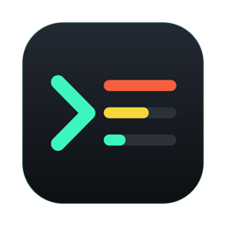

# TheExplorer

**A fast, native file explorer for macOS.**<br>
Real folder sizes, one bar for paths and search, previews of everything, and a storage map, in a dense dark UI built for the keyboard.


[Features](#features) · [Install](#install) · [Shortcuts](#keyboard-shortcuts) · [Development](#development)

<br>

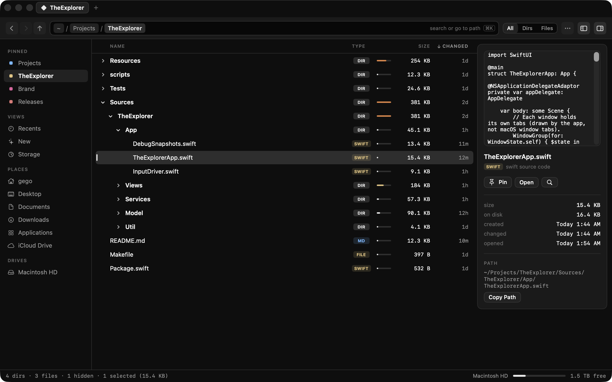

</div>

## Why

Finder makes simple things hard: telling folders from files at a glance, seeing how big a folder actually is, and finding out what's eating your disk. TheExplorer is a replacement built around those, written in Swift and SwiftUI and tuned to stay fast on folders with tens of thousands of files. Search runs on its own live index of your files rather than Spotlight, and a parallel `fts(3)` scanner measures disk usage.

## Features

### Real folder sizes

Every folder's total size is calculated in the background and drawn as a bar, so the heavy folders stand out. Type chips (`DIR`, `SWIFT`, `PDF`, `ZIP`…) tell folders from files at a glance, and you can filter to just folders or just files. Click a folder's arrow (or press →) to expand it in place; double-click still opens it.

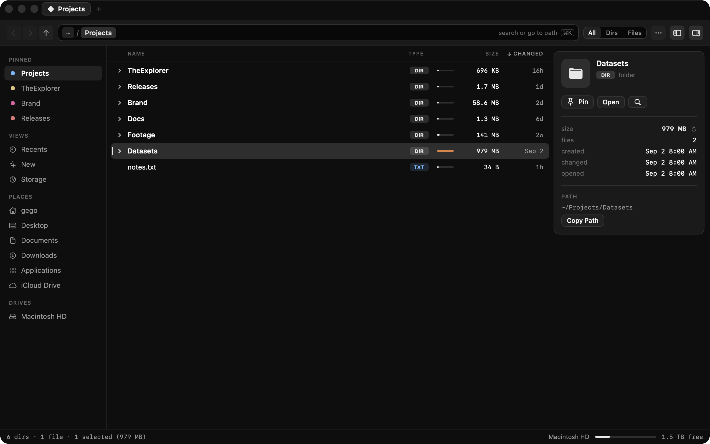

### One bar for paths and search

The command bar shows where you are as clickable chips. Press ⌘K and type to search, or start with `/` or `~` to jump to a path with folder completion (↑↓ to choose, ⇥ to complete). *Everywhere* searches all your files, and *Here* the current folder and everything below it.

Search works like a launcher's rather than Spotlight's. TheExplorer keeps its own index of file names: your home folder, Applications, iCloud Drive and cloud storage. The index is built once (about a second for a few hundred thousand files) and saved. FSEvents keeps it current from then on, so results update on every keystroke in a few milliseconds. At launch the saved index loads in a few milliseconds. FSEvents then replays whatever changed while the app was closed, and only those folders are re-read.
- **Fuzzy matching.** Matching is case- and accent-insensitive, and the letters you type don't have to be next to each other: `tex` finds *TheExplorer* and `qrp` finds *q3-report.pdf*.
- **Ranking.** Whole names beat prefixes, prefixes beat word starts, and those beat everything else. Recently opened and recently changed files rise to the top.
- **Folder words.** Extra words can match the folders a file is in, so `explorer readme` finds the README inside *TheExplorer*.
- **Recent folders.** TheExplorer learns which folders you work in, the way zoxide does: how often you visit, weighted toward the last hour and day. Passing through a folder doesn't count; staying a moment or opening a file there does. Open ⌘K without typing to see them, or use Go › Recent Folders. They rank higher in search, along with what's in them, so `expl` lands on the project you live in rather than another folder with a similar name, and path completion lists them first.
- **What's left out.** Library, hidden folders, the insides of apps and packages, dependency folders like `node_modules`, Unity's project caches, and any folder a project's `.gitignore` lists (build output, caches) aren't indexed, though the folders themselves are. Generated hash-named files rank last. To search everything in a folder, go there, show hidden files (⇧⌘.) and search *Here*.

<table>
  <tr>
    <td width="50%">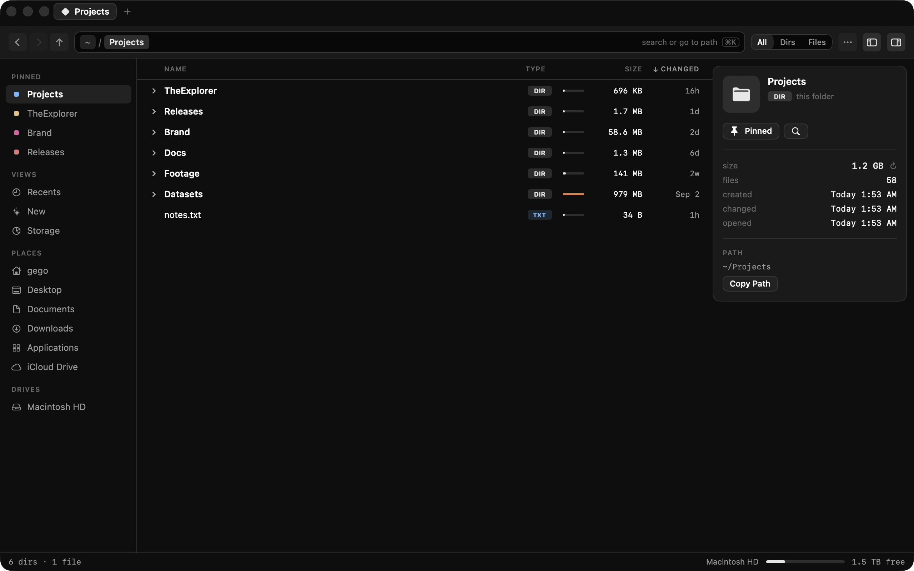</td>
    <td width="50%">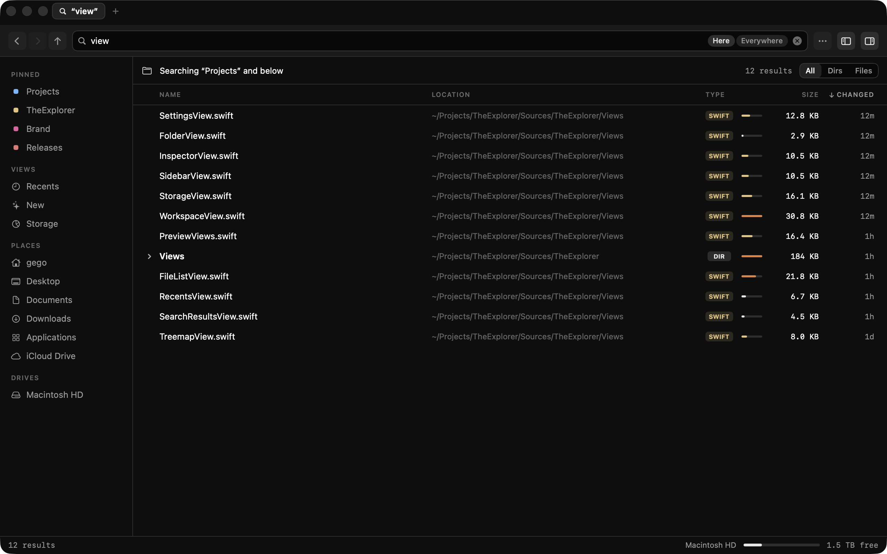</td>
  </tr>
  <tr>
    <td align="center"><sub>Jump anywhere with path completion</sub></td>
    <td align="center"><sub>Search this folder or the whole Mac</sub></td>
  </tr>
</table>

### Previews and zip archives

Selecting a document, image, PDF, video, audio or code file shows a live preview in the inspector, along with what's inside it:
- **Images:** dimensions, aspect ratio, color profile, and frame count and length for animations. Camera, lens and exposure appear for photos.
- **SVGs:** size and viewBox.
- **Video:** resolution, length, codec (H.264, HEVC, ProRes, AV1…), frame rate, HDR and bitrates.
- **Audio:** length, codec, sample rate and channels.
- **HLS playlists:** length and segments, or the variants.
- **Everything else:** page count and paper size for PDFs, family and styles for fonts, and line count for text and code.
 Space opens Quick Look, and ↑/↓ then step through every file in the list. Selecting a zip lists what's inside as a tree with sizes, without unpacking it: only the archive's table of contents is read, so even huge zips list instantly. Double-click a file inside to preview it, or drag files and folders out to unpack just those.

<table>
  <tr>
    <td width="50%">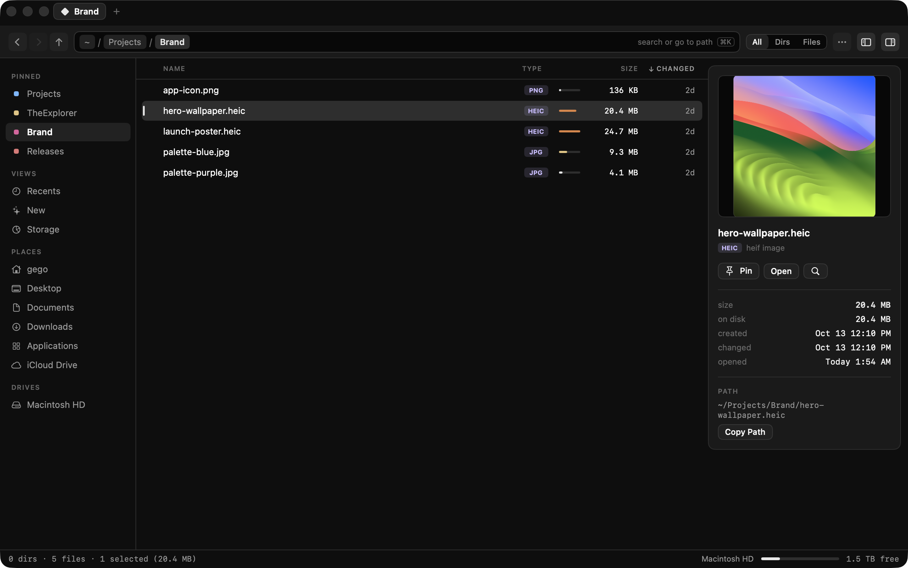</td>
    <td width="50%">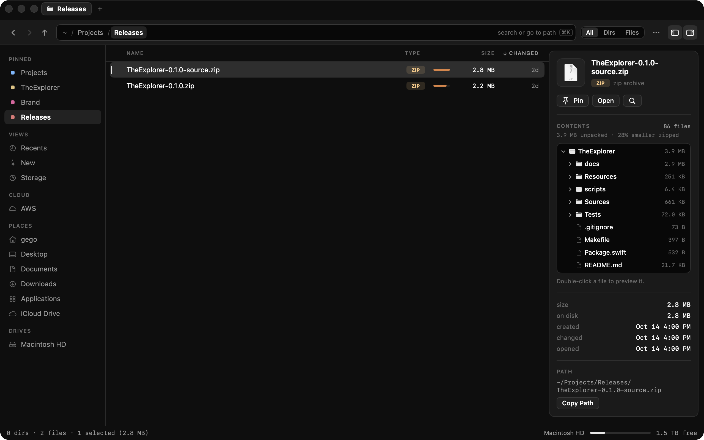</td>
  </tr>
  <tr>
    <td align="center"><sub>Live previews for images, PDFs, video and code</sub></td>
    <td align="center"><sub>Browse zips without unpacking them</sub></td>
  </tr>
</table>

### Storage map

Scan your home folder, the whole Mac, or any folder. Drill into a treemap and a ranked list with percentages, see the largest files, and compare against total disk usage. Moving something to the Trash updates the totals without a rescan.

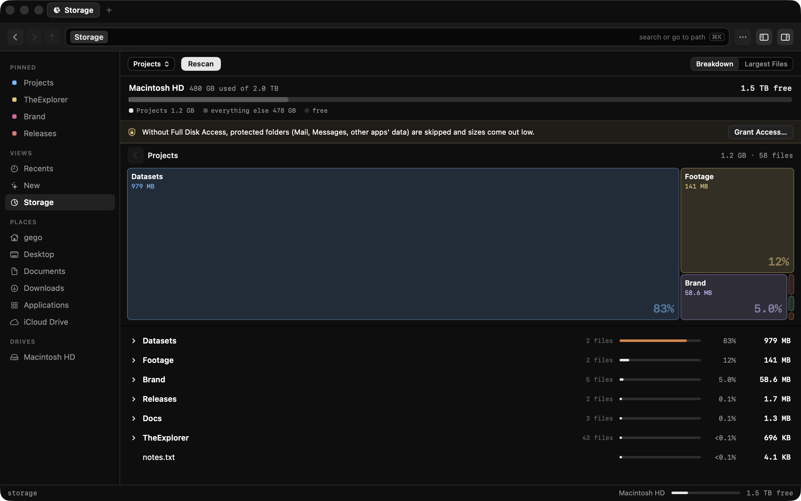

### S3, like a folder

Connect S3 in Settings › Cloud and your buckets show up in the sidebar. Browse them like any folder, with the same list, breadcrumbs, back/forward, filtering and inspector.

- **Upload:** drop files or folders onto an S3 folder, a folder row, a breadcrumb or the sidebar connection. Folders upload with everything in them, and big files upload in parallel parts.
- **Download:** drag S3 items onto any local folder, tab, sidebar place or breadcrumb, or right-click › Download. Double-click opens a file and Space previews it.
- **Share and manage:** right-click to copy an `s3://` URI or a share link that works for 7 days, create folders, or delete.
- **Progress:** the status bar shows progress with Stop for every transfer.
- **Credentials:** use your AWS CLI profiles as they are. That includes SSO and assumed roles, through `aws configure export-credentials`. Or add access keys, which are kept in your Keychain.
- **Other providers:** S3-compatible services (Cloudflare R2, MinIO, Backblaze B2, Wasabi…) work with a custom endpoint.

The app signs requests itself (AWS Signature Version 4, checked against AWS's published examples) and talks to S3 directly, with no SDK. One limit: S3 items can be dragged onto folders inside TheExplorer, but not straight to Finder or the desktop yet; use Download for those.

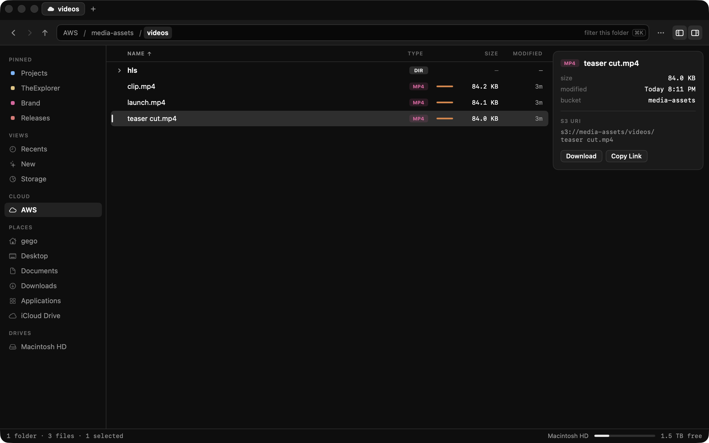

### Actions

Turn the shell commands you run on files into one-click actions. Define one in Settings › Actions (a name, the file types it applies to, and the command), then run it from the right-click menu or the Actions menu, where the first nine get ⌃⌥1–9. For example, converting a video to HLS:

```sh
mkdir -p "$NAME-hls"
ffmpeg -nostdin -hide_banner -y -i "$FILE" -codec copy -start_number 0 \
  -hls_time 10 -hls_list_size 0 -f hls "$NAME-hls/$NAME.m3u8"
```

Commands run in zsh with your login profile, so Homebrew tools like `ffmpeg` are found, and they run in the item's folder, so new files appear right next to it. They get `$FILE`, `$FILENAME`, `$NAME`, `$EXT` and `$DIR`, or every selected path as `"$@"` for actions that run once with all items. A status-bar indicator shows progress; click it for each run's output, or to stop one. Stopping ends everything the command started. Templates for HLS, WebP (80% quality, with cwebp), Zip and Copy SHA-256 get you started.

<p align="center">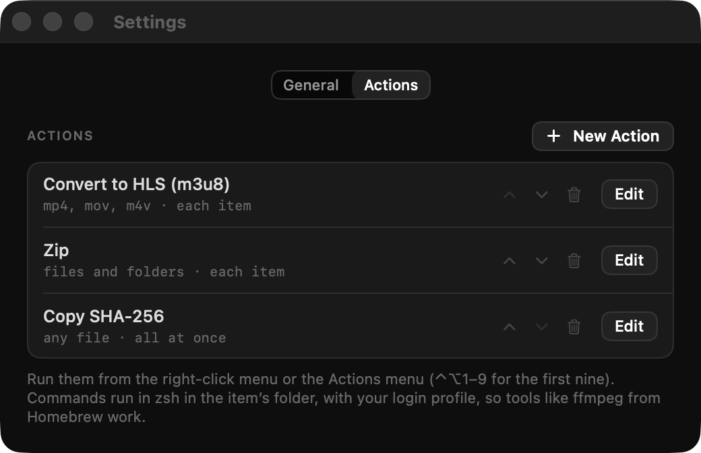</p>

### Recents and New

- **Recents** works like Finder's: every document you've opened, newest first, grouped into Today, Yesterday, Previous 7 Days, Previous 30 Days and then by month.
- **New** shows the newest files and folders in your home folder by date created, modified or added, from the last 24 hours to 90 days. It updates live, can hide clutter, and keeps loading as you scroll.

### Settings

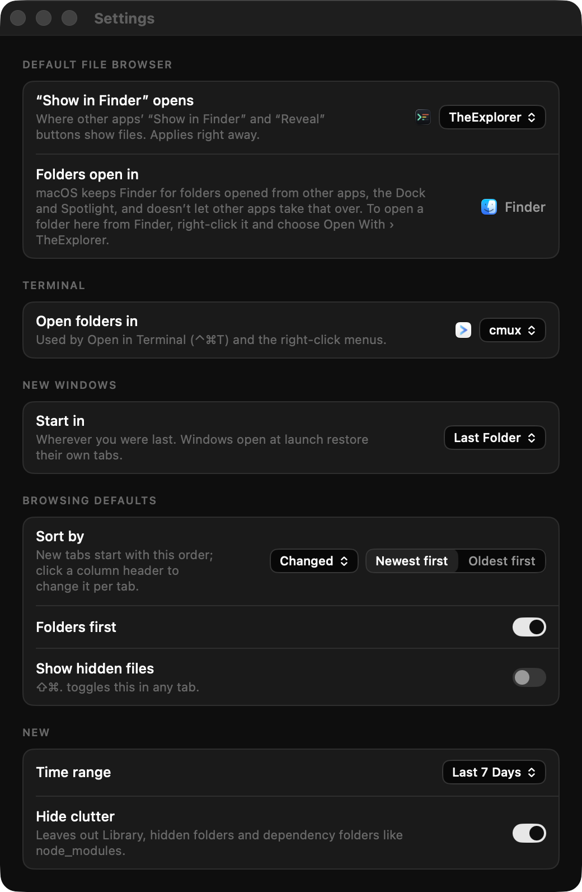

- **Default file browser.** Send other apps' "Show in Finder" and "Reveal" buttons to TheExplorer. Revealed items open in a tab with the items selected. macOS keeps Finder for folders opened from the Dock, Spotlight or other apps and doesn't let any app take that over, so Settings shows that too, along with the Open With workaround.
- **Terminal.** Choose what "Open in Terminal" (⌃⌘T) uses: Terminal, cmux, Ghostty, iTerm, Warp or any other app. cmux gets a new workspace in the folder.
- **Defaults.** Where new windows start, sort order, folders first, hidden files, and New's time range and clutter filter.

<br clear="right">

### And the rest

- **Tabs.** Browser-style tabs, each with its own folder, history and search. Drop files on a tab to move them there. Tabs come back where you left them after you quit.
- **Pinned.** Pin files or folders to the sidebar with ⌘D or by dropping them on the "Pinned" heading. Dropping onto a pinned folder moves items into it.
- **Git status.** In a repository, changed files get a letter: **M** modified, **A** added, **U** untracked, **R** renamed, red for deleted or conflicted. Folders get a dot when something inside changed, ignored files are dimmed, and the path bar shows the branch, ahead/behind and the number of changes. It updates as you edit, stage, commit or switch branches, including in git worktrees.
- **Cut, copy and paste.** ⌘X, ⌘C and ⌘V for files, including with Finder in either direction. Cut items fade until you paste them, ⌥⌘V moves whatever was copied, and Duplicate is in the right-click menu. Pasting into an S3 folder uploads.
- **Undo.** ⌘Z undoes the last move, copy, paste, rename, new item or Move to Trash, from any tab or window.
- **Drag and drop.** Between tabs, windows and Finder. Like Finder, it moves within a disk and copies across disks; hold ⌥ to copy. Name clashes keep both items and never overwrite.
- **Open With.** Right-click › Open With lists every app that can open the selection, with the one opening uses now first, plus Other… for any app. For files of one type, Always Open With makes your pick the default for that type. Settings › Open With lists these rules, and you can add your own: a list of types like `png, jpg, webp` and the app to open them in, with presets for images, video, audio, PDF, text and code. Rules apply to opening files from TheExplorer; macOS's defaults and other apps are left alone.
- **Right-click anywhere.** New folder or file, open in Terminal, copy path, pin, rename, Quick Look and more.
- **Keyboard first.** Back/forward history, ⌘↑ for the enclosing folder, arrow keys and type-to-select in every list.

## Install

TheExplorer builds from source. You need macOS 15 or later and Xcode 16 or later (Swift 6 toolchain).

```sh
git clone https://github.com/gego144/TheExplorer.git
cd TheExplorer
make run        # build, install to /Applications, and open it
```

Other targets:

```sh
make install    # build and install without opening
make test       # run the test suite
make clean
```

`make app` runs `scripts/build-app.sh`, which builds with SwiftPM and wraps the binary in an app bundle in `build/`. To work on the code in Xcode, run `open Package.swift`.

For the storage scan to include protected folders like Mail and Messages, grant **Full Disk Access** (System Settings › Privacy & Security › Full Disk Access). The Storage view has a button that opens the right pane.

## Keyboard shortcuts

| Action | Shortcut |
| --- | --- |
| New tab / Close tab | ⌘T / ⌘W |
| Next / previous tab, jump to tab | ⌃Tab / ⌃⇧Tab, ⌘1…⌘9 |
| Open folder in new tab | ⌥⌘↓ (or ⌘-double-click) |
| Search, jump to a path, or pick a recent folder | ⌘K or ⌘F |
| Edit the current path | ⌘L or ⇧⌘G |
| Back / Forward / Enclosing folder | ⌘[ / ⌘] / ⌘↑ |
| Open selection | ⌘↓, Return, or double-click |
| Expand / collapse a folder in place | → / ← |
| Quick Look (then ↑/↓ to step through the list) | Space or ⌘Y |
| Recents / New / Storage | ⇧⌘F / ⇧⌘E / ⇧⌘B |
| Home / Desktop / Documents / Downloads / Applications | ⇧⌘H / ⇧⌘D / ⇧⌘O / ⌥⌘L / ⇧⌘A |
| Pin or unpin in the sidebar | ⌘D |
| Show in enclosing folder / Reveal in Finder | ⌘R / ⌥⌘R |
| Cut / copy / paste files | ⌘X / ⌘C / ⌘V |
| Paste and move here | ⌥⌘V |
| Select all | ⌘A |
| Copy path | ⌥⌘C |
| New folder / New file / Rename | ⇧⌘N / ⌥⌘N / ⇧⌘↩ |
| Open current folder in Terminal | ⌃⌘T |
| Run action 1–9 on the selection | ⌃⌥1…⌃⌥9 |
| Move to Trash | ⌘⌫ |
| Undo / redo the last file change (any tab or window) | ⌘Z / ⇧⌘Z |
| Sidebar / Inspector / Hidden files | ⌥⌘S / ⌘I / ⇧⌘. |
| Refresh | ⇧⌘R |
| Settings | ⌘, |

## Development

```
Sources/TheExplorer/
  App/        App entry point, menu commands, tabs and session restore, debug scenes and input
  Model/      Per-window browser state, search, recents, storage, settings, actions
  Services/   Search index and fuzzy matcher, disk scanner, folder size cache, favorites, Spotlight wrapper (Recents), zip reader, S3 client and signer, directory watcher
  Views/      SwiftUI views (file list, sidebar, search, recents, storage and treemap, inspector, previews, settings)
  Util/       Formatting and icon caching
Resources/    Info.plist and app icon
scripts/      build-app.sh, make-icon.swift
Tests/        Swift Testing suites
docs/         README screenshots
```

A debug build (`CONFIG=debug ./scripts/build-app.sh`) goes to `build/debug/` with its own bundle identifier, so it never replaces the copy you use.

**Speed is a feature.** Anything proportional to the number of files (listing, sorting, search, Spotlight results, folder sizes, path suggestions) runs off the main thread, or runs once and is cached, never per redraw.

<details>
<summary><b>Signing and permissions</b></summary>

<br>

macOS remembers privacy permissions (Desktop, Documents, Downloads, Full Disk Access…) per app, identified by its code signature. An ad-hoc signature changes on every build, which makes macOS ask for permissions again after every rebuild. To avoid that, the build script signs with a stable identity:

1. `SIGN_IDENTITY`, if you set it (for example an Apple Development certificate).
2. Otherwise, a self-signed certificate called **TheExplorer Local Signing**, if it's in your keychain.
3. Otherwise, ad-hoc, with a warning.

To create the local certificate on a new Mac:

```sh
WORK=$(mktemp -d) && cd "$WORK"
printf '[req]\ndistinguished_name=dn\nx509_extensions=ext\nprompt=no\n[dn]\nCN=TheExplorer Local Signing\n[ext]\nbasicConstraints=critical,CA:false\nkeyUsage=critical,digitalSignature\nextendedKeyUsage=critical,codeSigning\n' > cert.cnf
/usr/bin/openssl req -x509 -newkey rsa:2048 -nodes -keyout key.pem -out cert.pem -days 3650 -config cert.cnf
/usr/bin/openssl pkcs12 -export -inkey key.pem -in cert.pem -name "TheExplorer Local Signing" -out id.p12 -passout pass:temp
security import id.p12 -k ~/Library/Keychains/login.keychain-db -P temp -T /usr/bin/codesign
cd - && rm -rf "$WORK"
```

It shows as "not trusted" in Keychain Access. That's expected for a self-signed certificate and doesn't stop it signing. To remove it, delete it in Keychain Access.

</details>

<details>
<summary><b>Scripted scenes and screenshots</b></summary>

<br>

Debug builds can drive themselves through a scripted set of scenes and save a screenshot of the window after each one, which is handy for checking UI changes without clicking through by hand:

```sh
CONFIG=debug ./scripts/build-app.sh
open -g -n --env EXPLORER_SNAPSHOT_DIR=/tmp/shots --env EXPLORER_SNAPSHOT_QUIT=1 \
    --env "EXPLORER_SCENES=folder:~/Dev;newtab:~/Downloads;recents;search:swift;searchmac:swift;storage:~/Dev" \
    build/debug/TheExplorer.app
```

Scenes are separated by `;`. The available scenes are `folder:<path>`, `select:<path>`, `newtab:<path>`, `tab:<n>`, `omnibox:<text>`, `expand:<path>`, `recents`, `new`, `range:<days>` (0 for all time), `more` (load the next page), `search:<text>`, `searchmac:<text>`, `scope:mac|folder`, `create:folder|file`, `drop:<source>><folder>`, `storage[:<path>]`, `settings[:actions]` (shows the Settings window, optionally on its Actions tab), `actioneditor` (shows the action editor; `type:` scenes after it go to the command field), `editortext` (logs the command field), `runs` (logs every action run's state and output), `stop` (stops the newest running action), `menu:<name>` (logs a menu bar menu's items), `s3:[bucket/prefix/]` (browses the first S3 connection), `transfers` (logs uploads and downloads), `back`, `reveal:<path>[,<path>…]` (sends the app the reveal event other apps' "Show in Finder" uses), `viewer:<bundle id>` (sets the file viewer and logs it back; pass the current one to change nothing) and `wait:<seconds>`.

Scenes can also drive the app with real input:

- `key:<combo>`: a key press such as `key:cmd+k`, `key:down` or `key:esc`.
- `type:<text>`: types the text into whatever has focus.
- `click:<row name>`, `dblclick:<row name>`, `cmdclick:<row name>`: clicks a row in the list. Rows inside a zip in the inspector are named `debug-rows/<path in the zip>`.
- `chevron:<row name>`: clicks a folder's expand arrow.
- `scroll[:<points>]`: scrolls the list one step per frame and reports frame times, hitches, and the longest wait at the bottom for the next page. Leave out the distance to scroll until the list stops growing; negative distances scroll up.

The events go only to the app's own window (see `App/InputDriver.swift`), so they never touch your mouse or keyboard and need no permissions. Launch with `open -g` so the app never takes focus; running the binary directly can leave the app without a window. To run fully hidden and just read the log, add `-j` and `--env EXPLORER_NO_CAPTURE=1`. Don't double-click file rows in scenes: opening a file launches its app.

**README screenshots** come from demo mode. `EXPLORER_DEMO=1` shows only the startup disk in the sidebar and puts the window on a Retina screen, so captures are sharp. `EXPLORER_DEMO_PINS` sets the pinned folders (paths separated by `;`), and demo pins are never saved over your own. Point the scenes at a demo folder rather than your own files. `EXPLORER_ACTIONS_FILE` and `EXPLORER_S3_FILE` give a run its own action list and S3 connections, so tests never touch yours. `drop:` accepts `s3:bucket/key` for S3 items.

</details>

<details>
<summary><b>Measuring speed</b></summary>

<br>

Scripted runs also watch the main thread. After each scene the log reports how long the scene took to show something, plus the worst main-thread stall during it. Anything over 250ms is also logged on its own line as `[hang]`:

```
[snapshot] recents timing: first content 0.08s, worst main-thread stall 49ms, stalls>100ms 0 · …
```

Debug builds aren't optimized, so build with `SWIFT_FLAGS="-Xswiftc -O" CONFIG=debug ./scripts/build-app.sh` to get numbers that match the release app. A folder with tens of thousands of files makes a good stress test.

</details>

<details>
<summary><b>App icon</b></summary>

<br>

The icon is drawn in code. After changing `scripts/make-icon.swift`, regenerate it with:

```sh
swift scripts/make-icon.swift   # writes Resources/AppIcon.icns
sips -s format png -z 256 256 Resources/AppIcon.icns --out docs/icon.png
```

</details>

<details>
<summary><b>Testing S3 without AWS</b></summary>

<br>

The S3 client's integration tests run against any S3-compatible server; they're skipped unless one is set:

```sh
python3 -m venv /tmp/motoenv && /tmp/motoenv/bin/pip install "moto[server]"
/tmp/motoenv/bin/moto_server -p 5055 &
EXPLORER_S3_TEST_ENDPOINT=http://127.0.0.1:5055 swift test --filter S3
```

</details>

## Contributing

Issues and pull requests are welcome. Before opening a PR, run `make test`. For UI changes, check them with the scripted scenes above, and refresh the screenshots in `docs/screenshots/` if the look changed.

## License

No license has been chosen yet, so all rights are reserved for now.
